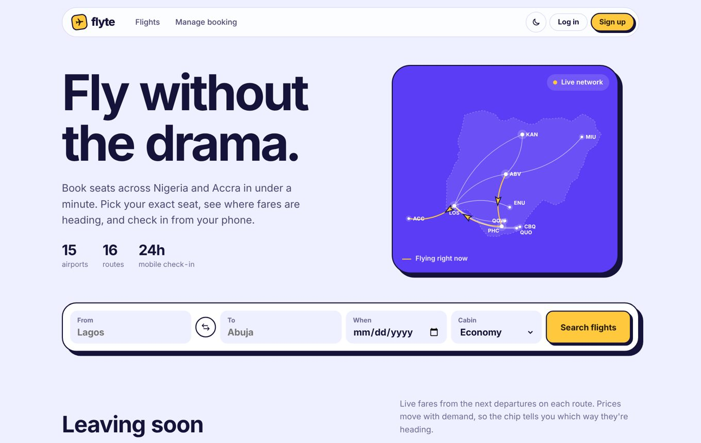
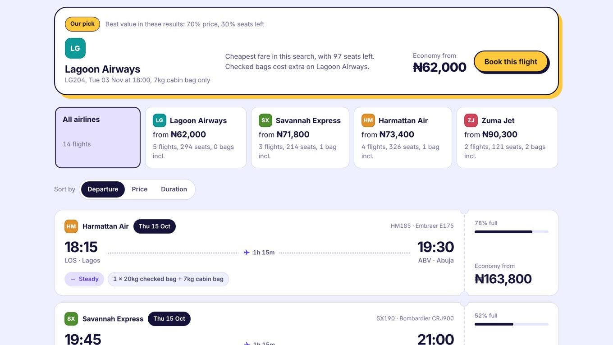
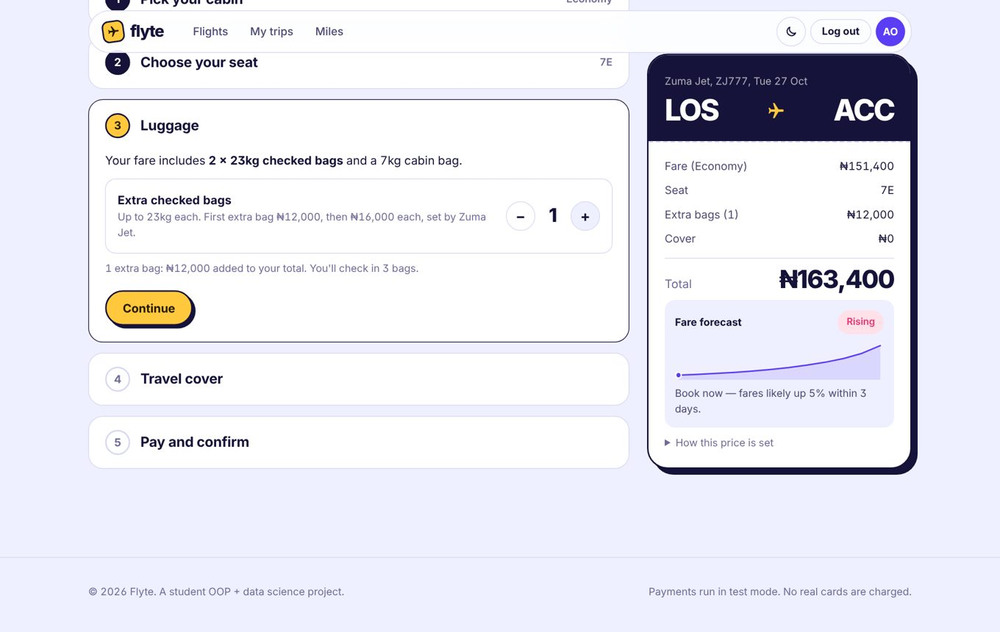
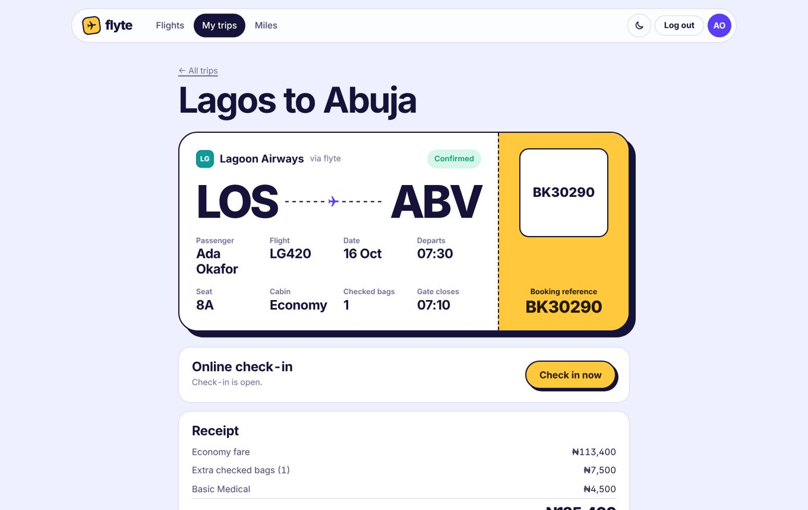
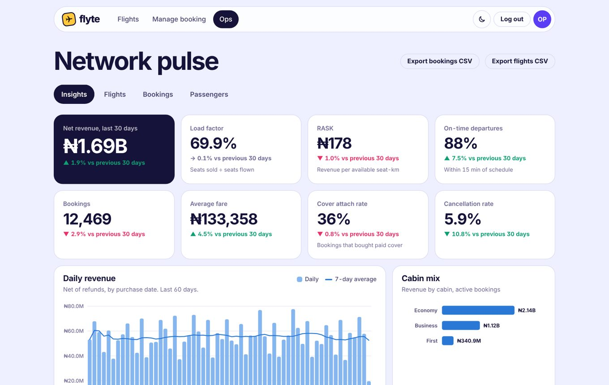

# Flyte ✈ — airline booking + analytics web app

Your console **Airline Flight Management System** rebuilt as a web app you could launch.
The OOP core is still the heart of it. `Passenger`, `Flight`, `Booking`, `AirlineSystem`,
the custom errors and the enums are all still there, extended rather than replaced.
Your original `ConsoleUI` also still runs on the same database.



| Compare airlines, get a recommendation | Pick a seat and add luggage |
|---|---|
|  |  |
| **Boarding pass with check-in** | **Ops dashboard (pandas + NumPy)** |
|  |  |

**Built with:** Python (OOP), Flask, pandas, NumPy, SQLite, vanilla JavaScript. 29 automated tests.
The airlines, passengers and bookings are fictional demo data.

---

> 📘 Step-by-step guides: **[docs/RUNNING.md](docs/RUNNING.md)** (local + demo script) and **[docs/DEPLOYMENT.md](docs/DEPLOYMENT.md)** (GitHub, hosting, launch limitations).

## 1. Run it locally in VS Code (5 minutes)

**You need:** Python 3.10+ and VS Code with the Python extension.

```bash
# 1. open the folder in VS Code, then in the terminal:
python -m venv .venv

# 2. activate it
#    Windows (PowerShell):  .venv\Scripts\Activate.ps1
#    macOS / Linux:         source .venv/bin/activate

# 3. install
pip install -r requirements.txt

# 4. (optional) copy settings
copy .env.example .env        # Windows
cp .env.example .env          # macOS / Linux

# 5. run
python app.py
```

Open **http://127.0.0.1:5000**. The first start takes about 10 seconds because it seeds
three months of realistic demo data (4 fictional airlines, 3,500 passengers, ~480 flights, ~29,000 bookings).

You can also press **F5** in VS Code and pick **"Flyte: web app"**. The `.vscode/` folder
has debug configs for the web app, the original console app and the tests.

| Demo login | Email | Password |
|---|---|---|
| Traveller (has a flight you can check in for right now) | `ada@flyte.ng` | `Demo1234` |
| Ops admin (analytics dashboard) | `admin@flyte.ng` | `FlyteAdmin2026` |

Test cards: `4242 4242 4242 4242` is approved and `4000 0000 0000 0002` is declined.
Use any future expiry date and any 3-digit code.

Other commands:

```bash
python -m airline.cli                    # your ORIGINAL console menu, same database
python -m unittest discover -s tests -v  # 29 tests
python manage.py reset-demo              # wipe and reseed demo data
python manage.py stats                   # KPIs in the terminal
```

---

## 2. What the app does

**Travellers**
- Search by city, date and cabin. Results are boarding-pass cards with the airline, live fares, how full the flight is, the bag allowance and a *fares rising / steady* signal.
- **Compare airlines**: four (fictional) carriers fly the same routes at different price levels with different baggage rules. A row of airline cards shows each one's cheapest fare, flights, seats and bags included; click one to filter.
- **Our pick**: `AirlineRecommender` scores every flight in the search (70% price, 30% seats left) and explains its choice, e.g. "Only ₦3,000 more than the cheapest flight, which has just 1 seat left."
- A 5-step booking flow: cabin, then an **interactive seat map** (First, Business and Economy zones), then **luggage** (extra checked bags priced by that airline's `BaggagePolicy`), then travel cover, then card payment.
- A **fare forecast** sparkline that says "book now" or "wait", based on how fast that flight is selling.
- A boarding pass with a **QR code**, confetti when you book, and a live countdown.
- **Online check-in** opens 24h before departure and assigns a boarding group.
- **Cancel with an automatic refund** using a real policy: 90% if more than 72h out, 50% within 24–72h, 0% inside 24h, and a full refund for Premium cover or airline cancellations.
- **Loyalty miles** based on distance flown, with Blue, Silver, Gold and Platinum tiers.
- Guests can look up a booking with its reference and email.

**Ops staff (admin)**
- **Airlines on Flyte**: revenue share, average fare, load factor, on-time rate and extra-bag uptake per airline.
- **Insights dashboard** with KPIs: net revenue, load factor, RASK, on-time departures, average fare, cover attach rate and cancellation rate, each compared with the previous 30 days.
- Daily revenue with a 7-day moving average.
- A **14-day demand forecast** with an 80% confidence band and a backtest error (MAPE).
- Booking lead time against fares, showing why booking early is cheaper.
- Top routes by revenue, load factor and yield per km.
- A weekday × hour booking heatmap.
- **Customer segmentation**: K-means clustering written from scratch, scored with a silhouette value.
- **Flights selling slowly**: an anomaly check that compares each flight with the usual booking curve.
- A split-flap departures board.
- Schedule management: add flights, set delays (passengers get notified), change fares, and cancel a flight with automatic refunds for everyone on it.
- Bookings and passengers tables with search and paging, plus **CSV exports** you can open in Jupyter. The passenger export is anonymised.

---

## 3. How the OOP fits together

```
airline/                       ← pure Python domain package (no Flask inside)
├── errors.py                  AirlineError → FlightFullError, SeatOccupiedError, PaymentError …
├── enums.py                   FlightClass, InsuranceTier(+price), BookingStatus, FlightStatus, LoyaltyTier, Role
├── models/
│   ├── passenger.py           Passenger        (+ loyalty tier, miles)
│   ├── flight.py              Flight           (+ cabins, load factor, status, distance)
│   ├── booking.py             Booking          (+ frozen fare, check-in, refund)
│   ├── airport.py             Airport, AirportDirectory
│   ├── carrier.py             Airline, BaggagePolicy, AirlineDirectory  (an Airline HAS a BaggagePolicy)
│   └── user.py                User             (login identity, hashed password)
├── services/
│   ├── airline_system.py      AirlineSystem    ← your original class, same method names
│   ├── storage.py             StorageBackend (ABC) → JsonStorage | SqliteStorage
│   ├── pricing.py             PricingEngine, FareQuote, FareAdvisor, RefundPolicy, LoyaltyProgram
│   ├── recommend.py           AirlineRecommender, FareOption, Recommendation
│   ├── payments.py            PaymentGateway (ABC) → MockPaymentGateway, CardDetails
│   └── notifier.py            Notifier (ABC) → LogNotifier | SmtpNotifier, NotificationService
├── analytics/
│   ├── engine.py              AnalyticsEngine  (pandas KPIs)
│   ├── forecasting.py         Forecaster (ABC) → SeasonalTrendForecaster
│   └── segmentation.py        KMeans, PassengerSegmenter
├── seed.py                    DemoDataSeeder + Persona
└── cli.py                     ConsoleUI        ← your original menu
web/                           ← Flask layer (class-based views)
├── __init__.py                FlyteApp (application factory)
├── security.py                Auth, CSRFGuard, LoginThrottle, SecurityHeaders
├── views/                     BaseView/JsonView → HomeView, FlightsView, CheckoutView, DashboardView …
├── templates/  static/        Jinja pages, CSS design system, ES-module JS classes
tests/                         unittest suites for the domain, analytics and web
```

The OOP ideas you can point to:
- **Inheritance**: the error hierarchy, `BaseView` → `JsonView` → API views, and `Chart` → `TimeChart` / `BarChart` in JS.
- **Abstraction and polymorphism**: `StorageBackend`, `PaymentGateway`, `Notifier` and `Forecaster` are abstract base classes with swappable implementations.
- **Encapsulation**: `Booking` freezes its fare, `Flight` owns its seat inventory, `Passenger` owns miles and tier logic.
- **Composition and dependency injection**: `AirlineSystem` receives its storage, pricing, payments and notifier, which is why the tests can run against in-memory SQLite.
- **Class methods and properties**: `from_dict` / `to_dict` serialisation, plus `@property` for `load_factor`, `total_cost` and `loyalty_tier`.

### Bugs fixed from the console version
- Fares were recalculated from the flight on every read, so an old booking's price changed whenever the fare changed. Fares are now frozen on the booking.
- Cancelling did not take back the miles earned, and it deleted the booking from history. Now miles are revoked and history is kept.
- You could buy an Economy ticket and sit in row 1. Seats now belong to a cabin.
- Passport lookup was case-sensitive.
- Arrival could be before departure and origin could equal destination. Flights are now validated.
- The insurance price came from the UI. It is now set on the server.
- The sample flights were dated in the past. They are now generated relative to today.

### Your old database still works
If an `airline_db.json` from the console app sits next to `app.py` when you first start, it is
imported automatically (including the old list-style format).

---

## 4. The data science, briefly

| Feature | Method |
|---|---|
| Dynamic pricing | `fare = list × clamp((0.90 + 0.75·LF²) × (0.95 + 0.45·e^(−days/5)))`, so fares rise with cabin load factor and as departure nears |
| Fare forecast for travellers | Projects the load factor forward from 7-day booking velocity (accelerating near departure), then re-prices each day |
| Demand forecast | Ridge least-squares on `[1, t, weekday dummies]`, an 80% interval from residual σ, and a 14-day hold-out backtest (MAPE / MAE) |
| Segmentation | Features `trips`, `log(spend)`, `lead_days`, `premium_share`, z-scored, then K-means++ with 6 restarts and a silhouette score. Clusters are auto-named from their centroids |
| Slow-selling flights | Builds the typical booking curve from departed flights (share of final seats sold *d* days out) and flags flights more than 8 points behind it |
| Airline KPIs | Load factor, RASK (₦ per available seat-km, from great-circle distances), OTP (departures within 15 min), attach rate, cancellation rate |

The demo data comes from four behavioural personas (commuters, planners, occasional flyers
and premium flyers), each with its own lead time, cabin mix and insurance habits. That gives
the clustering a real structure to find.

---

## 5. Deploying it

See **[docs/DEPLOYMENT.md](docs/DEPLOYMENT.md)**. Short version:
- **Free demo:** PythonAnywhere (persistent SQLite, one worker). Steps are in the guide, and `deploy/pythonanywhere_wsgi.py` is ready to paste.
- **From GitHub, always on:** Render via the included `render.yaml` (paid instance + 1 GB disk).
- **Anywhere:** the `Dockerfile`.

Keep **one worker** and a **persistent disk**. The guide's Part 3 lists what's still needed for real customers, with live payments at the top.

---

Fonts load from Google Fonts (Bricolage Grotesque and Instrument Sans). The app falls back
to system fonts when you're offline. Charts are drawn in plain SVG with no chart library.
